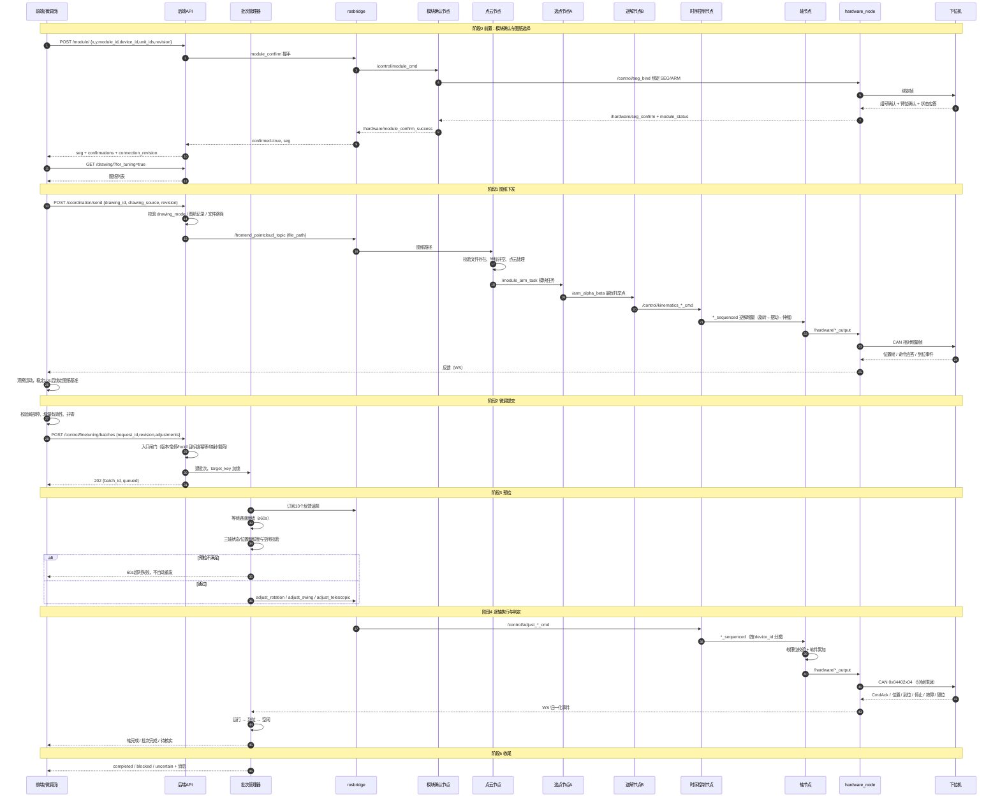

# 前端图纸到微调下发全流程说明

> 适用范围：MES 前端「微调页」从图纸选择、机械臂确认，到微调增量提交、下发、反馈判定的完整链路。
> 依据：`mes_web/ros_mes_front`、`mes_web/ros_mes_hou`、`robot_control_backend` 当前代码，以及 2026-11 真机实测记录。
> 文中区分「代码支持」与「真机已确认」，未确认项单独标注。

---

## 1. 角色与链路总览

| 角色 | 对应实现 | 职责 |
|---|---|---|
| 前端 | `ros_mes_front` 微调页 | 选图纸、确认机械臂、录入增量、提交批次、展示反馈与状态 |
| 后端 API | FastAPI `ros_mes_hou` | 入口闸门、图纸下发、批次登记、反馈归一化、完成判定 |
| rosbridge | `ros_mes_hou/app/ros/rosbridge.py` | 与 ROS 建立 WebSocket，发布指令、订阅反馈 |
| 点云节点 | `data_process_node.py` | 图纸路径转点云、切分模块、发布 `/module_arm_task` |
| 选点节点（节点A） | `calculation_node.py` | 逐模块选取最优托举点，发布 `/arm_alpha_beta` |
| 逆解节点（节点B） | `kinematics_node.py` | 托举点转三轴增量，发布 `/control/kinematics_*_cmd` |
| 模块确认节点 | `module_confirme_node.py` | UID 宣告握手、SEG/ARM 绑定与状态复核 |
| 时序控制节点 | `control_node.py` | 逆解分阶段排序、等待到位、微调指令转发 |
| 轴节点 | `rotation_node.py` / `swing_node.py` / `telescopic_node.py` | 软限位校验、增量累加、写库、下发 |
| 硬件桥 | `hardware_node.py` | 模块确认、CAN 组帧/分帧/限速、反馈解析 |
| 下位机 | F407 + 驱动器 | 执行相对增量、回传位置/应答/事件/状态 |

---

## 2. 阶段0：前置确认

### 2.1 前端检查

| 检查项 | 代码位置 | 不满足时的反应 |
|---|---|---|
| 选择 1~5 台机械臂 | `FineTuningPage.vue` `confirmInitConfig` | `请选择 1-5 台机械臂` |
| 非调试模式必须选图纸 | 同上 | `必须选择一张图纸才能继续` |
| 所选机械臂仍可用 | 同上 | `所选机械臂已不可用，请重新选择` |
| 模块确认返回 200 | 同上 | `机械臂模块确认失败`（或后端 message） |
| 所有臂均确认成功 | 同上 | `所选机械臂未全部确认成功，请重新确认` |
| SEG 有效（0~14） | 同上 | `模块确认响应缺少有效 SEG，无法核验反馈归属` |
| 会话登记结果 | 同上 | 不阻断，提示 `本次握手已完成，但会话登记失败，离开页面后需重新握手` |

确认成功后，前端记录 `confirmedSeg`、`confirmedConnectionRevision`、`confirmedUnitIds`；后续图纸与微调请求都携带这些值。

### 2.2 后端检查（`POST /module/`）

| 条件 | 失败返回 |
|---|---|
| `connection_revision` 与当前一致 | 409 `连接设置已更改，请重新读取设置后确认机械臂` |
| `unit_ids` 非空、≤5、整数、不重复 | 422 `缺少 unit_ids：请选择至少一台机械臂` / `unit_ids 最多选择 5 台机械臂` / `unit_ids 必须全部是整数` / `unit_ids 不能重复` |
| 坐标 x/y 存在且参数合法 | 422 `missing x or y coordinate` / `invalid module parameters` |
| 急停联锁已解除（rosbridge 分发层校验） | 409 `当前急停联锁尚未解除，禁止模块确认或任务下发` |
| 握手在超时内收到成功回执 | 502，detail.message=`机械臂模块确认失败，已停止后续确认`，附带 `failed_unit_id/failed_arm/confirmed_unit_ids/pending_unit_ids/reason` |

### 2.3 ROS 端行为与日志

`module_confirme_node.py` 状态机：`IDLE → WAIT_ANNOUNCE → WAIT_CONFIRM → 状态复核 → READY`。

| 事件 | 日志原文 |
|---|---|
| 开始握手 | `🔌 开始确认 SEG%d 臂%d（占用全局AXIS %d~%d），请给该臂上电，等待 UID 宣告（30.0s）` |
| 收到宣告 | `📢 收到宣告：UID56=%X（槽%d）→ 绑定 SEG=%d ARM=%d` |
| 组号确认 | `🤝 组号确认通过：UID56=%X SEG=%d` |
| 臂位确认 | `🤝 臂位确认通过：UID56=%X ARM=%d AxisBase=%d` |
| 已绑定快速通道 | `⚡ SEG%d 臂%d 已绑定且电机就绪（状态应答 Token=0x%04X），跳过 UID 宣告等待` |
| 等待超时 | `等待 UID 宣告超时（30.0s）：请检查该臂电源、CAN 接线` |
| 状态异常 | `模块状态异常（state=0x%02X，bit0已绑定/bit1允许运动应均为1）` |
| 已 READY 臂重新上电 | `🔌 SEG%d 臂%d 重新上电，绑定已失效，需重新确认` |

### 2.4 下位机应回传

| 帧 | 内容 | 说明 |
|---|---|---|
| UID 宣告 | UID56 + 槽位 | 模块上电且未绑定时周期广播；已绑定模块不广播，必须断电重启 |
| 组号确认 | `0x15BC0050`，Result=0 | 与绑定帧对应 |
| 臂位确认 | `0x15BC0060`，ARM + AxisBase | 与期望不符会被忽略 |
| 状态查询应答 | `0x00002060+(SEG<<18)` | 电机存在/就绪掩码（0x07）+ 模块状态位 |

---

## 3. 阶段1：图纸选择与下发

### 3.1 前端

- 图纸列表：`GET /drawing/?for_tuning=true`；模拟模式下额外返回「内置模拟图纸」。
- 图纸选择对话框：非调试模式必须选择图纸，按钮为「确认并下发」；调试模式跳过图纸。
- 逐台机械臂调用 `POST /coordination/send`，携带 `device_id / module_id / unit_id / unit_row_id / drawing_id / drawing_source / connection_revision`。
- 任一臂失败即中止并显示后端 message；全部成功后才 `confirmDrawingBaseline` 进入基准观察。

### 3.2 后端检查（`coordination.py`）

| 条件 | 失败返回 |
|---|---|
| 连接版本一致 | 409 `连接配置已更改，请重新确认机械臂后下发图纸` |
| 图纸模式不是 skip | 409 `当前选择不使用图纸，不允许下发图纸` |
| `device_id/module_id/unit_id/unit_row_id` 齐全 | 422 `missing ...` |
| `drawing_source ∈ {database, builtin_mock}` | 422 `invalid drawing source` |
| 内置图纸仅模拟模式且不带 drawing_id | 422 `内置图纸仅用于模拟下发，不接受业务图纸编号` |
| 数据库图纸存在且未删除 | 404 `drawing not found` |
| 图纸文件路径非空 | 422 `drawing file path is empty` |
| rosbridge 发布成功 | 502（RosbridgeError 原文） |
| 三视图生成成功（非模拟） | 504 `pointcloud views generation timed out` |

成功后返回 `message`：模拟为 `图纸下发模拟成功，三视图为模拟预览`，真机为 `target drawing path dispatched and pointcloud views are ready`。

### 3.3 ROS 端行为与日志

`data_process_node.py` 收到 `/frontend_pointcloud_topic` 后：

1. 解析 `file_path`；相对路径按脚本目录解析；
2. 读取图纸 JSON 的 `虚拟部件列表 → 坐标列表`，取 `全局X/Y/Z(mm)`；
3. 毫米转厘米，统计滤波/PCA 摆正/原点移动/模块切分；
4. 发布 `/module_arm_task`（JSON 字符串）给节点A（选点节点）。

| 情况 | 日志原文 |
|---|---|
| 收到路径 | `📂 收到图纸路径: <abs path>` |
| 文件不存在 | `❌ 图纸文件不存在: <abs path>` |
| 无坐标 | `❌ JSON文件中没有找到坐标数据` |
| 缺字段 | `缺少 points 或 file_path 字段` |
| 发送模块 | `📤 已发送 N 个模块` |

> 注意：图纸处理失败只打 ROS 日志，**不会回执后端**；前端表现为“图纸已下发但机械臂不动”，只能通过 ROS 日志定位。

逆解阶段的下发由 `control_node.py` 按「旋转 → 摆动 → 伸缩」顺序执行，**主判断是到位事件**：

1. 每阶段先算出本阶段增量非空的轴（`_axes_with_motion`）；
2. 下发前清除这些轴的旧到位标记，避免上一拍事件误判；
3. 发布本阶段指令后等待这些轴的 `arrive_notification`，且要求 `status_bits & 0x04`；
4. 全部到位才进入下一阶段。

旧的“按固定等待时间推进阶段”已不再作为判断依据；代码中仅保留 2 分钟兜底超时（`ARRIVE_TIMEOUT_S`），超时只告警并放行，避免整条链路卡死。

### 3.4 下位机应回传

图纸本身不产生 CAN 指令。只有逆解节点生成增量后才会下发，下位机回传同「阶段4」。

---

## 4. 图纸基准锁定（阶段1补充，仅图纸模式）

`drawingBaseline.ts` 规则：

| 规则 | 值 |
|---|---|
| 观察前提 | 必须先用 `axis_status.axis_state==1` 或 `status_bits & 2` 观测到运动 |
| 采样新鲜度 | 三轴采样间隔 ≤ 3000ms |
| 稳定判定 | 三轴位置窗口内波动 ≤ 0.01（° 或 mm） |
| 锁定时长 | 连续稳定 10s（`DRAWING_BASELINE_STABLE_MS`） |
| 锁定条件 | 已确认下发 + 窗口完整 + 稳定满 10s |

页面标签文案：

- `等待图纸下发后采集固定基准`
- `图纸下发中，正在观察机械臂运动`
- `等待图纸运动反馈`
- `等待连续有效的三轴位置反馈`
- `图纸固定基准已锁定，后续微调沿用这组基准`
- `图纸下发结果待核实，固定基准尚未锁定`

> 基准未锁定不阻止微调提交（`isReady` 只要求已配置、臂已确认、图纸已选），但此时“实际值”缺少可靠基准，建议先完成锁定。

---

## 5. 阶段2：微调录入与提交

### 5.1 前端校验

| 条件 | 提示原文 |
|---|---|
| 模块处于局部停 | `该模块处于局部停状态，请先清除局部停记录再下发` |
| 增量为有限数值 | `请输入有效的微调增量` |
| 至少一个非零增量 | `没有待下发的非零调整` |
| 提交请求 | `POST /control/finetuning/batches`，字段 `request_id/module_id/unit_id/adjustments/connection_revision` |

- `request_id` 使用 UUID，仅提交非零轴；
- 前端不做每轴角度范围限制，负值可提交，限位由轴节点判定；
- 提交期间进入 `submitting`，锁定目标；失败时保留 request_id 查询，不自动重发；
- 409 时查询 `/batches/active`：有活动批次则接入，否则标记 `blocked`；422/401 直接标记 `blocked`；其他错误提示 `提交结果待确认，请查询本次请求；不会自动重发`。

### 5.2 后端入口闸门（`POST /control/finetuning/batches`）

| 闸门 | 通过条件 | 失败返回 |
|---|---|---|
| 连接版本 | 空或等于 `dispatcher.revision` | 409 `连接配置已更改，请重新确认机械臂后提交` |
| 运行期配置 | `runtime_settings.operation(revision)` 内版本未变化 | 409 |
| 急停 | `ControlSafety.state` 不以 `stop` 开头 | 409 `急停联锁尚未解除，禁止运动下发` |
| 局部停 | 模块/臂/轴无未清除 hold | 409 `该目标已执行局部停（模块停/臂停/轴停），需操作员确认清除后才能继续下发` |
| 目标锁 | 无同 `seg:arm` 的 `target_key` 批次 | 409 `该机械臂存在执行中或待核实批次，禁止重复下发` |
| 映射 | `resolve_module_seg` 成功、`resolve_arm_from_unit_id` 成功 | 422 |
| 目标映射不明 | 无任何在途批次时可继续 | 409 `目标映射不明且存在执行批次，禁止运动下发` |
| 幂等 | 同 request_id 且载荷一致 → 返回旧批次 | 409 `请求编号已用于另一组调整，禁止复用` |
| 机械臂登记 | `Unit` 表存在该 module+unit | 422 `机械臂未登记在该模块中` |
| 唯一约束 | `target_key` 插入成功 | 409 `机械臂已被另一批次占用` |

创建成功返回 `202`、`message=批次已登记，执行状态以查询结果为准`，初始状态：

- `status=queued`
- `message=等待新鲜轴状态，尚未发送运动指令`
- `target_key=<seg>:<arm>`（模拟模式加 `mock:` 前缀）

### 5.3 旧同步接口差异

`POST /control/finetuning` 只做：

- 轴号一致性：`(arm-1)*3+参数序号+1`，不符返回 422 `轴号、机械臂和参数类型不匹配`；
- `assert_available`（急停/局部停/目标锁）；
- 载荷校验。

**没有**反馈预检、运行/到位判定，发布成功即返回 `微调指令已写入 rosbridge 连接，尚无设备确认`。

### 5.4 前端反馈展示与超时

| 项 | 规则 |
|---|---|
| 数据来源 | 后端 WebSocket 推送的归一化反馈（`data_type`/`module_id`/`device_id`/`position_valid`） |
| 过滤 | `module_id` 必须等于已确认 SEG；`device_id` 必须映射到当前臂的轴；`position_valid === false` 视为无效 |
| 初始值 | 下位机与 ROS 不回传初始基准，三轴“实际值”初始按 0 记录，不从反馈反推 |
| 轴反馈超时 | 默认 60s（`VITE_ROS_AXIS_STALE_MS`），压力 10s，IMU 5s |
| 超时后 | 保留最后收到的数值，状态标签变为“数据已过期”，不会自动清零 |

状态标签原文：

- `等待反馈`
- `实时反馈`
- `历史缓存 · 等待新反馈`
- `数据已过期`
- `模拟数据`

> 若同一话题存在模拟发布者，其数值会与真实反馈混流展示；联调结束后必须确认模拟节点已退出，否则会出现“实际值跳变到 0”等现象。

---

## 6. 阶段3：执行前预检

`BatchManager` 默认参数：`state_timeout=60s`、`motion_timeout=60s`、`freshness=3s`。

### 6.1 通道与状态

1. 订阅 13 个反馈话题（三轴位置、传感器、压力均值、IMU、CmdAck、AxisStatus、到位、停止、故障、限位、失压）；
2. 等待 `ready`（订阅消息全部发出后置位），超时 60s：
   `等待反馈通道就绪超时；未发送运动指令`；
3. 每轴下发前重新校验，不能凭 HTTP 成功推进。

### 6.2 通过条件

| 对象 | 条件 |
|---|---|
| 轴状态帧 | 新鲜 ≤3s；`axis_state ∈ {0,2}`；bit1 与 bit6 均为 0；`base_valid == 1`；`status_bits` 为整数 |
| 位置采样 | 新鲜 ≤3s；`position_valid == true`；`position` 有限；数据类型与轴号匹配（旋转/摆动/伸缩） |
| 三轴范围 | 当前臂 3 个轴全部满足，缺一不可 |
| 发送瞬间 | 再次复查三轴空闲；否则 `发送前检测到机械臂忙，尚未发送本轴` |

状态期间显示：`等待当前臂三轴有效空闲状态和实测位置`。

任一条件长期不满足 → 60s 后失败：`等待有效状态或运动完成超时；未自动重发`。

若调试设置关闭 `finetuning_preflight_enabled`：

- 跳过状态与位置检查；
- 消息变为 `已跳过下发前状态和位置检查，准备发送相对增量`；
- 仍执行急停/取消/熔断判定。

---

## 7. 阶段4：逐轴下发

### 7.1 下发链路

1. 后端组装 `fine_tuning` 消息（参数名、增量、module_id、device_id）；
2. rosbridge 发布 `/control/adjust_rotation_cmd` / `adjust_swing_cmd` / `adjust_telescopic_cmd`；
3. `control_node` 校验来源话题（不匹配时 `⚠️ ... 指令来源话题不匹配：actual=... expected=...，已放行处理`），转发到 `*_sequenced`；
4. 轴节点软限位校验并累加；
5. `hardware_node` 组 CAN 帧，分帧限速下发；
6. 下位机执行并回传。

### 7.2 轴节点软限位（`rob_arm.env`）

| 轴 | 范围 | 单位 |
|---|---|---|
| 旋转 | -180 ~ +180 | ° |
| 摆动 | -15 ~ +15 | ° |
| 伸缩 | -10 ~ +20 | mm |

超限日志：

- `⚠️ Arm%d 旋转超位：当前 ... 超出 [-180.0, 180.0]，指令已丢弃`
- `⚠️ Arm%d 摆动超位：当前 ... 超出 [-15.0, 15.0]，指令已丢弃`
- `⚠️ Arm%d 伸缩超位：当前 ... 超出 [-10.0, 20.0]，指令已丢弃`

通过日志：

- `Arm1 旋转增量：+5.0000° → 下发 500(0.01°) | 位置变量 +5.000°`
- `Arm1 摆动增量：...`
- `Arm1 伸缩增量：+2.000mm → 下发 200(0.01mm) | 长度变量 +2.000mm`

轴节点的位置变量是**软件累加值**，不以下位机反馈回写；变量漂移会导致限位误判，失真时需重启节点归零。

### 7.3 hardware_node 下发规则

| 参数 | 值 |
|---|---|
| CAN | 2.0B，500kbps，29 位扩展帧，大端 |
| ID 位域 | `PRI(3) / GRP(4) / SEG(4) / NODE(5) / AXIS(5) / DIR(2) / MSG(4)` |
| 单帧增量上限 | `CAN_MAX_DELTA_CENTIDEG=30000`（即 300.00° / 300.00mm） |
| 分帧周期 | `CAN_CHUNK_PERIOD=0.05s`，每轴 FIFO 每周期一帧 |
| 速度限制 | `CAN_DEFAULT_SPEED_LIMIT=500`（单位 0.01°/s，即 5°/s；伸缩轴即 5mm/s） |
| 发送后等待反馈 | `CAN_TX_WAIT_TIMEOUT=5.0s`，超时视为反馈丢失继续 |
| 运动载荷 | `struct.pack('>hH', delta, speed)` |

日志：

- `📤 轴%d 相对增量 %+d(%s) → 排入 %d 帧`
- `📤 轴%d 相对增量 %+d(%s) → 0x%08X（SEG=%d）`
- `❌ CAN 发送失败 0x%08X: ...`
- `⚠️ CAN 发送失败且设备已掉线，关闭句柄等待重连`

### 7.4 下位机应回传帧

| 帧 | 位置 | 格式 | 说明 |
|---|---|---|---|
| 位置（单轴） | GRP=2 DIR=PERIODIC MSG=0 | `>i`，0.01°/0.01mm | 运动过程中上报 |
| 位置（打包） | GRP=2 DIR=PERIODIC MSG=4 | `start_axis, count, >h×3` | DLC=8 |
| 轴状态字 | GRP=2 DIR=PERIODIC MSG=3 | `u16 status_bits + axis_state` | `base_valid = bit8` |
| 命令应答 | GRP=2 DIR=PERIODIC MSG=5 | `ack_msg, result, detail` | `0=OK 1=忙 2=基准无效 3=越界 4=故障 5=急停锁存` |
| 到位通知 | GRP=3 DIR=EVENT MSG=0 | `>i angle, >h pos_err, status_bits, flags` | `flags bit0` 固件恒 0 |
| 停止通知 | GRP=3 DIR=EVENT MSG=1 | `reason, output_level` | `1=到位 2=急停 3=命令停止` |
| 轴故障 | GRP=3 DIR=EVENT MSG=2 | `u16 fault_bits, action, detail, u16 duration` | — |
| 回零状态 | GRP=3 DIR=EVENT MSG=3 | `result, base_valid, >i angle` | 固件当前不支持回零 |
| 吸盘失压 | 臂级 EVENTS MSG=0 | `>i pressure_raw, u16 threshold` | device_id 21~25 |
| 心跳/看门狗 | 节点级 | — | 代码中已注释，固件无心跳 |

对应日志：

- `🎯 轴1 到位 angle=... pos_err=... status=0x.. flags=0x..(原始0x..)`
- `🛑 轴1 停止 reason=1(1=到位2=急停3=命令停止) output=...`
- `📝 轴1 命令应答 result=3 越界（ack_msg=.. detail=..）`
- `❌ 轴1 故障 bits=0x....`
- `🌀 吸盘失压 臂=1 pressure=... threshold=...`
- `🏠 轴1 回零 result=.. base_valid=.. angle=..`

> `hardware_node` 对到位帧执行 `flags | 0x01`：因固件不回传基准，ROS 侧强制按“基准有效”上报。`axis_status.base_valid` **没有**同样的兜底。

---

## 8. 阶段5：完成判定与失败处置

### 8.1 单轴完成（三条依次满足）

1. **运行**：发送时刻之后，目标轴 `axis_state==1` 或 `status_bits & 2`；
2. **到位**：`arrive_notification` 且：
   - `status_bits & 4`（到位）
   - `flags & 1`（基准有效，ROS 代填）
   - `status_bits` 的 bit5/bit7 均为 0
   - `angle`、`pos_error` 为数值
3. **空闲**：运行之后该轴 `axis_status` 新鲜、`axis_state ∈ {0,2}`、bit1/bit6 清零。

容差：旋转/摆动 0.2°、伸缩 0.1mm，**只写 warning，不阻断**。

### 8.2 熔断条件（命中即停止后续轴）

| 条件 | 消息 |
|---|---|
| 取消/急停 generation 变化 | `控制联锁或急停状态已变化，结果待核实` |
| 反馈断开 | `反馈断开，执行结果待核实` |
| 当前臂 CmdAck `result != 0` | `收到可能属于当前臂的拒绝回执（result=N），停止后续下发` |
| 当前臂失压 | `当前机械臂出现失压事件，停止后续下发` |
| 当前臂故障/限位 | `当前机械臂出现故障/限位事件，停止后续下发` |
| 非正常停止原因 | `收到非正常到位的停止事件，执行结果待核实` |
| 状态字 bit3/4/5/7 或 `axis_state==3` | `轴处于限位、故障或急停状态` |
| 状态字段缺失/基准无效（预检开启） | `轴状态缺少有效基准/状态字段，禁止继续下发` |
| 其他轴并行运动 | `其他轴出现并行运动，停止后续下发` |
| 状态/运动超时（60s） | `等待有效状态或运动完成超时；未自动重发` |
| 目标位置非有限值 | `目标位置无效，尚未发送本轴` |
| 发送前忙 | `发送前检测到机械臂忙，尚未发送本轴` |

### 8.3 批次状态

| 状态 | 说明 | 是否保留目标锁 |
|---|---|---|
| `queued` | 已登记，未发送 | 是 |
| `checking` | 等待预检或反馈就绪 | 是 |
| `executing` | 逐轴下发中 | 是 |
| `completed` | 全部轴观测到运行、到位、空闲 | 否（解锁） |
| `blocked` | 未发送任何轴即失败 | 否（解锁） |
| `uncertain` | 已发送但结果不明，或急停/局部停/重启 | 是，需人工核实关闭 |
| `closed` | 人工核实后关闭 | 否 |

- 成功消息：`本批次各轴已观测到运行、目标到位和空闲反馈`；有超容差时追加 `；N 个轴到位误差超出容差，已记录提示但未阻止下发`；
- 后端重启恢复：`后端重启，执行结果待现场核实；未恢复或重发指令`；
- 急停：`已请求急停，停止后续下发；设备实际状态待确认`；
- 局部停：`已执行局部停，停止后续下发；设备实际状态待确认`；
- 中断接口：`已停止后续下发；已发送动作的结果仍需核实`；
- 人工关闭：`操作者已现场核实并关闭 MES 批次；未重发任何指令`。

---

## 9. 缺失项与反应速查

| 缺失/异常 | 前端表现 | 后端表现 | ROS/日志 | 下位机 |
|---|---|---|---|---|
| 机械臂未确认 | 禁止提交 | `/module/` 失败 | `等待 UID 宣告超时...` | 无宣告/确认帧 |
| 图纸文件丢失 | 图纸已下发但无运动 | 返回 200 | `❌ 图纸文件不存在` | 无 |
| 图纸无坐标 | 同上 | 返回 200 | `❌ JSON文件中没有找到坐标数据` | 无 |
| 连接版本过期 | 重新确认提示 | 409 | 无 | 无 |
| 急停未解除 | 提交被拒 | 409 `急停联锁尚未解除，禁止运动下发` | 无 | 急停锁存 |
| 局部停未清 | 提交被拒 | 409 局部停提示（模块停/臂停/轴停） | 无 | 无 |
| 存在在途批次 | 提交被拒 | 409 `...禁止重复下发` | 无 | 无 |
| 状态字缺失 | 一直“执行中” | 60s 超时失败 | 无专用日志 | 未发 MSG=3 |
| 位置反馈缺失 | 数值不更新/过期 | 运行/到位超时 | 无专用日志 | 未发位置帧 |
| 轴超软限位 | 状态无变化 | 批次等待后超时 | `⚠️ ...超位...指令已丢弃` | 未收到运动帧 |
| 下位机拒绝 | 状态无变化 | `result!=0` 熔断 | `📝 轴1 命令应答 result=3 越界` | CmdAck |
| 反馈断开 | 数据过期 | `反馈断开，执行结果待核实` | rosbridge 断开 | 无 |
| 后端重启 | 待核实 | `uncertain` | 无 | 可能已执行 |

---

## 10. 当前真机实测缺口（2026-11 确认）

| 项 | 现状 | 影响 |
|---|---|---|
| 轴状态字 `MSG=3` | 真机未观测到周期上报；仅虚拟遥测节点补发 | 预检开启时批次必然 60s 超时 |
| 空闲位置帧 | 固件空闲时不发位置帧（运动结束后静默） | 预检“位置新鲜 ≤3s”在静止时无法满足 |
| 到位 `flags bit0` | 固件恒 0，`hardware_node` 强制置 1 | 后端 `flags&1` 判定依赖 ROS 代填 |
| `axis_status.base_valid` | 取自状态字 bit8，无 ROS 兜底 | 无状态字即无法通过 |
| 心跳 | 固件不支持，代码已注释 | 无节点级在线检测 |
| 模块已绑定 | 上电不广播 UID | 必须断电重启模块才能重新确认 |
| 摆动轴位置变量 | 纯软件累加，不按反馈校准 | 变量失真会导致限位误判 |
| 轴1 | 曾出现指令被接受但电机不动作 | 需持续排查驱动器/编码器/接线 |

> 结论：在现有固件下，真实环境跑通「批次预检」需要满足以下之一：
> 1. 固件新增周期性 `MSG=3` 状态字上报（推荐）；
> 2. 临时关闭 `finetuning_preflight_enabled`；
> 3. 启用虚拟遥测节点补全（仅联调用，会引入模拟数据）。

---

## 11. 附录：关键接口、话题与参数

### 11.1 接口

| 方法 | 路径 | 用途 |
|---|---|---|
| GET | `/drawing/?for_tuning=true` | 微调可用图纸 |
| POST | `/module/` | 模块确认与 SEG/ARM 绑定 |
| POST | `/coordination/send` | 图纸下发 |
| POST | `/control/finetuning/batches` | 微调批次提交（202） |
| GET | `/control/finetuning/batches/{id}` | 批次状态 |
| GET | `/control/finetuning/batches/active` | 当前目标批次 |
| GET | `/control/finetuning/batches/by-request/{request_id}` | 按请求号查询 |
| POST | `/control/finetuning/batches/{id}/interrupt` | 停止后续下发 |
| POST | `/control/stop/clear` | 清除模块局部停（不发指令） |

### 11.2 关键话题

| 话题 | 方向 | 用途 |
|---|---|---|
| `/frontend_pointcloud_topic` | 后端 → ROS | 图纸路径 |
| `/module_arm_task` | 点云节点 → 选点节点A | 模块任务 |
| `/arm_alpha_beta` | 选点节点A → 逆解节点B | 最优托举点 |
| `/control/adjust_*_cmd` | rosbridge → 控制节点 | 微调增量 |
| `/control/*_cmd_sequenced` | 控制节点 → 轴节点 | 统一执行话题 |
| `/hardware/rotation_output` / `swing_output` / `telescope_output` | 轴节点 → hardware | 轴增量 |
| `/hardware/can/*_raw` | hardware → feedback | 原始反馈 |
| `/hardware/axis_status` | hardware → 后端 | 状态字（当前无真机数据） |
| `/hardware/arrive_notification` | hardware → 后端 | 到位 |
| `/hardware/cmd_ack` | hardware → 后端 | 命令应答 |
| `/hardware/vacuum_loss` | hardware → 后端 | 失压 |

### 11.3 关键参数

| 参数 | 值 | 说明 |
|---|---|---|
| `ROTATION_MIN/MAX_ANGLE` | -180 / 180 | 旋转软限位 |
| `SWING_MIN_ANGLE` / `MAX_SWING_ANGLE` | -15 / 15 | 摆动软限位 |
| `TELESCOPIC_MIN/MAX_MM` | 0 / 30 | 伸缩软限位 |
| `CAN_DEFAULT_SPEED_LIMIT` | 500 | 5°/s 或 5mm/s |
| `CAN_CHUNK_PERIOD` | 0.05s | 分帧周期 |
| `CAN_TX_WAIT_TIMEOUT` | 5.0s | 等待位置反馈 |
| `MODULE_CONFIRM_WAIT_ANNOUNCE_S` | 30.0s | 等 UID 宣告 |
| `state_timeout` / `motion_timeout` | 60s / 60s | 批次超时 |
| `freshness` | 3s | 反馈新鲜度 |

### 11.4 日志提示速查

| 阶段 | 来源 | 关键日志/文案 |
|---|---|---|
| 模块确认 | 节点 `module_confirme_node` | `🔌 开始确认 SEG%d 臂%d...`、`📢 收到宣告...`、`🤝 组号确认通过...`、`⚡ ...已绑定且电机就绪...`、`等待 UID 宣告超时（30.0s）...`、`模块状态异常...` |
| 图纸下发 | 后端 | 409/422/404/504 的 detail.message |
| 图纸处理 | `data_process_node` | `📂 收到图纸路径...`、`❌ 图纸文件不存在...`、`❌ JSON文件中没有找到坐标数据`、`📤 已发送 N 个模块` |
| 逆解/时序 | `control_node` | `⚠️ ... 指令来源话题不匹配...已放行处理`、`[微调] 🎯 Arm1 旋转 -> 5.00`、`[时序] 模块X 旋转阶段全部到位：AXIS [...]`、`...等待到位超时（120s 兜底），未到位：AXIS [...]，继续下一阶段` |
| 轴限位 | 轴节点 | `⚠️ Arm%d 旋转/摆动/伸缩超位...指令已丢弃` |
| 轴下发 | 轴节点 | `Arm1 旋转增量：+5.0000° → 下发 500(0.01°)...` |
| CAN 发送 | `hardware_node` | `📤 轴%d 相对增量 ... → 排入 %d 帧`、`... → 0x%08X（SEG=%d）`、`❌ CAN 发送失败...` |
| 下位机应答 | `hardware_node` | `📝 轴%d 命令应答 result=...`、`🎯 轴%d 到位...`、`🛑 轴%d 停止...`、`❌ 轴%d 故障...`、`🌀 吸盘失压...` |
| 批次 | 后端 | `等待新鲜轴状态，尚未发送运动指令`、`等待反馈通道就绪超时；未发送运动指令`、`等待有效状态或运动完成超时；未自动重发`、`本批次各轴已观测到运行、目标到位和空闲反馈` |
| 前端 | 页面 | `等待反馈`、`实时反馈`、`历史缓存 · 等待新反馈`、`数据已过期`、`模拟数据` |

---

*文档生成时间：2026-11-14*
